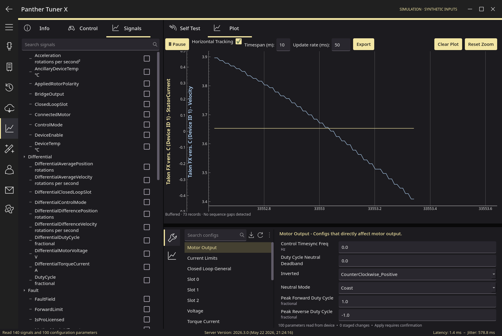

# Panther Tuner X

An independent, MIT-licensed desktop workbench for CTRE Phoenix 6 devices, with pastel yellow accents and a dark desktop theme. Native Qt UI for **Linux, Windows, and macOS**. Uses CTRE's actual Phoenix Diagnostics Server and the official Phoenix SDK, including an isolated CTRE simulation mode.

**Status: working early release, verified against the official Phoenix 26.3.0 simulator. Physical hardware has not been available for validation.** This is not a complete replacement for every Tuner X feature; see the capability table below.



## Run

Install [Python 3.12](https://www.python.org/downloads/) and [uv](https://docs.astral.sh/uv/getting-started/installation/), then:

```sh
uv sync --frozen
uv run panther-tuner
```

To start with simulated devices:

```sh
uv run panther-tuner --simulate
```

To connect to a roboRIO over USB:

```sh
uv run panther-tuner --host 172.22.11.2
```

The default launch is disconnected. It does not create simulated hardware or send device mutations. Select a connection in the top-left menu and click Connect. Local simulation and local hardware each need port **1250** free. Existing servers can be accessed through Network mode.

Linux desktop needs Qt's system libraries. On Ubuntu 22.04/24.04:

```sh
sudo apt install libegl1 libopengl0 libxcb-cursor0 libxkbcommon-x11-0 libxcb-icccm4 libxcb-image0 libxcb-keysyms1 libxcb-render-util0
```

The pinned Phoenix wheel requires glibc 2.35 or later on Linux; Windows x64 and macOS 13+ SDK wheels are available. Native hardware on macOS is not supported by CTRE; use network diagnostics. Builds must be made on the target OS, as described in [installation](docs/installation.md).

## Connect hardware

**roboRIO:** run a robot program that instantiates a Phoenix device, which starts CTRE's Diagnostics Server. Enter the controller address (USB `172.22.11.2`, Ethernet `10.TE.AM.2`, or a hostname) and port 1250. No bridge or robot-code changes specific to Panther are required. Existing Tuner X diagnostics servers are used directly.

**Linux / Windows local CAN:** install [CTRE's Phoenix 6 runtime and CANivore drivers](https://v6.docs.ctr-electronics.com/en/stable/docs/installation/installation-nonfrc.html). Select Local CAN / CANivore. Linux supports configured SocketCAN interfaces and CANivore; Windows requires CANivore (use `*` for any CANivore). The app starts CTRE's SDK and Diagnostics Server in a separate process. Bus enumeration remains the vendor server's responsibility. See [hardware validation](docs/hardware-validation.md) before relying on hardware operations.

**macOS:** use a remote roboRIO/Linux/Windows diagnostics server. Simulation works locally.

## Workflow

1. Connect and open a device card, or double-click a table row. Discovery refreshes every three seconds; device history is stored locally.
2. Open **Signals** on the left and **Plot** on the right. Each selected signal has its own colored Y axis. Adjust the fetch interval (20–2000 ms) and display timespan, pause, pan/zoom, inspect nearest values, or export CSV. Acquisition uses the server's buffered records, timestamps and ordinals; overlapping fetches are deduplicated. CSV contains the entire capture, including records evicted from the display window and previously selected signals. Overruns are counted and drawn as gaps.
3. In **Control**, select a server-advertised request and stage parameters. **Enable** requires confirmation and verifies the target; it does not send output. **Apply control request** sends the staged command and starts a renewable heartbeat. **Stop**, leaving Control, switching devices, disconnecting, or a communication error stops the heartbeat and requests neutral output. Local SDK enable has an independent expiring lease. FRC still requires Driver Station enable.
4. Read all reported configuration groups in the lower pane. Edit numeric fields, enums and booleans, with units, ranges, defaults and explanatory tooltips from the device server. Search groups by parameter name.
5. **Review & apply** shows a diff and asks for explicit confirmation. The app refreshes before writing and rejects concurrent configuration changes. After applying, it reads back actual values and reports any differences, including firmware quantization.
6. **Self test** collects a snapshot with all reported diagnostic signals and highlights asserted faults. Copy the JSON for troubleshooting.
7. **Info** exposes reported details, blink/clear sticky faults, device naming and CAN ID changes. Each mutation requires confirmation.

Imports and factory defaults only stage changes; they never write until Review & apply. Files use Panther's versioned JSON format, with model matching and validation; these are not claimed to be Tuner X import-compatible files.

## Capabilities and limitations

| Feature | Implementation |
|---|---|
| Discovery | Actual `getdevices` responses, including name, model, ID, bus, firmware, serial and status |
| Phoenix 6 configurations | All groups and fields returned by `getconfigv2`; read, edit, validate, import/export, stage defaults, review/write/readback |
| Devices | Talon FX, Talon FXS, CANcoder, Pigeon 2, CANrange, CANdi and CANdle, as exposed by the server |
| Self-test | Actual decorated self-test values, named using the server signal catalog; no active motor test |
| Telemetry | Verified `plotpro` buffered acquisition, server timestamps/ordinals, overlap deduplication, overrun detection, independent Y axes, pause, zoom, hover, full-capture CSV; display capped at 60,000 records while all acquired records are spooled to disk |
| Device administration | Blink / clear sticky faults and rename verified in simulation. CAN ID change requests are implemented, but the vendor simulator rejects them; physical validation is needed |
| Simulation | Official CTRE SDK in a separate process; explicitly synthetic sensor physics; no real CAN |
| macOS hardware | Remote server only; vendor SDK does not support local CANivore on macOS |
| Control requests | All request types/parameters advertised by `getcontrols`; typed validation, explicit Enable + Apply, Stop and watchdogs. Duty-cycle output/stop verified in vendor simulation; other modes require hardware/firmware validation |
| Phoenix 5 | Discovery/details may be reported; v5 configuration and telemetry not supported |
| Firmware, licensing, server deployment | Not implemented; use official CTRE tools |
| Calibration, generators, device LEDs animation | Not implemented |
| Hardware verification | Not performed; current wire protocol tested against CTRE 26.3.0 simulation only |

Control requests can activate motors. Use an independent emergency stop and secure the mechanism before enabling controls. Local SDK enable is fed only while an explicitly applied request heartbeat succeeds; a 250 ms lease plus the 100 ms SDK timeout bounds a stalled client. The server also times out missing request heartbeats (verified on 26.3.0 simulation; physical firmware and other versions remain unverified). Network non-FRC programs must supply their own Phoenix enable feed, as described in [CTRE’s actuator documentation](https://v6.docs.ctr-electronics.com/en/stable/docs/api-reference/api-usage/enabling-actuators.html). Configuration can also affect subsequent motion: disable the robot, secure the mechanism, and review every change. Do not run competing configuration writers. A timeout can leave a write partially applied; refresh before retrying. CTRE's blink command also clears sticky faults and the confirmation explicitly says so.

“Lossless” means every record retained and returned by the server is preserved without client decimation. It does not guarantee every physical CAN update: server sampling and a finite ring buffer impose limits. The tested server produces roughly 100 records/s; capacity is 1,000 records (about 10 s at that rate). The UI reports sequence gaps rather than hiding loss. Fetch interval is not the CAN signal frequency. Capture storage is temporary: export before Clear, opening another device, disconnecting, or closing. Changing signals preserves prior records and CSV columns. See [plot and control protocol details](docs/protocol.md).

## Develop and test

```sh
uv sync --frozen
uv run ruff check .
uv run ruff format --check .
QT_QPA_PLATFORM=offscreen uv run pytest
```

On PowerShell, set `$env:QT_QPA_PLATFORM = "offscreen"` before `uv run pytest`. Integration tests launch the **actual official CTRE simulation server**, exercise discovery, configuration write/readback, buffered plotting, simulated control output/watchdogs and self-tests, and clean up the child process. They require port 1250 free. No physical devices are contacted by tests.

```sh
uv run python tools/build.py
```

Produces a PyInstaller desktop bundle in `dist/PantherTunerX`. CI runs lint, tests and packaging on Ubuntu, Windows and macOS. Pinned dependencies and `uv.lock` make the build inputs reproducible; byte-for-byte binary reproducibility and signed installers are not claimed.

Architecture: [design](docs/architecture.md) · [research and sources](docs/research.md) · [verified wire protocol](docs/protocol.md) · [validation results](docs/validation.md) · [hardware acceptance checks](docs/hardware-validation.md).

Device cards use bundled official CTRE product images; their source URLs and ownership are recorded in [third-party notices](THIRD_PARTY_NOTICES.md).

Not affiliated with CTR Electronics. Phoenix and CTRE marks belong to their owners. This app's code is MIT; the separately installed Phoenix SDK is proprietary and retains CTRE's license. See [third-party notices](THIRD_PARTY_NOTICES.md).
