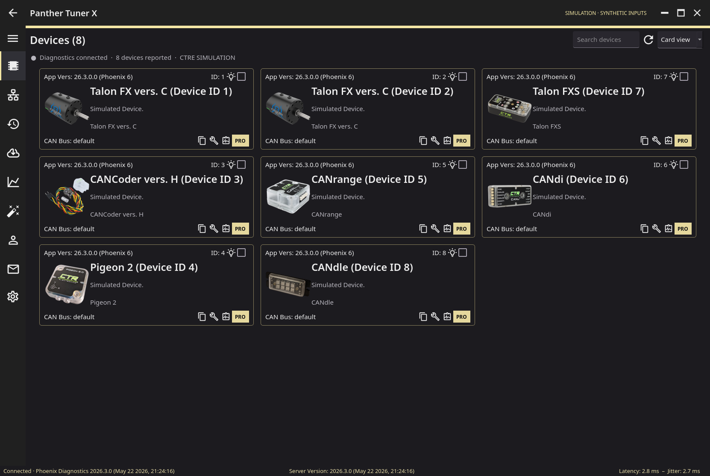
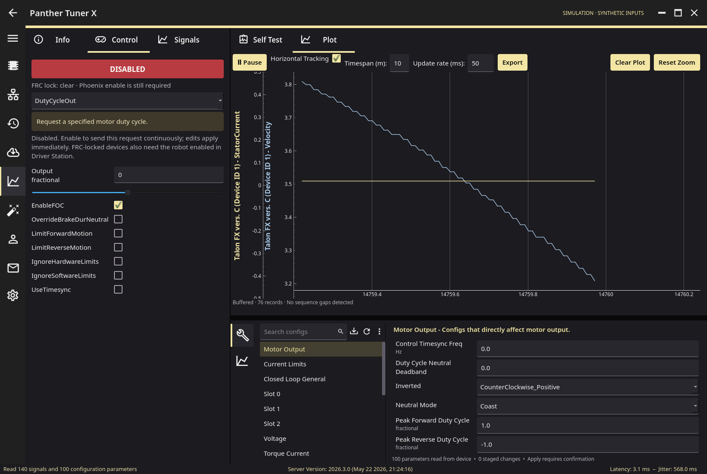

# Panther Tuner X

**A cross-platform desktop workbench for CTRE Phoenix 6 devices.**

[](https://github.com/RohanBhattacharyya/PantherTunerX/actions/workflows/ci.yml?query=branch%3Amain)
[](LICENSE)


Discover devices, inspect diagnostics, capture buffered telemetry, edit configurations, and send explicit control requests from one native Qt workspace. Linux is a first-class platform, with pastel yellow accents, a dark theme, and official device imagery.

[Install](#installation) · [Quick start](#quick-start) · [Documentation](#documentation) · [Contribute](#development)


> [!IMPORTANT]
> **Early release.** Verified against CTRE's official Phoenix 26.3.0 simulator. Physical CAN hardware has not yet been validated. Firmware flashing, licensing, calibration, generators, and Phoenix 5 configuration are not implemented.

## Features

| | |
|---|---|
| **Device discovery** | Names, CAN IDs, models, firmware, serial numbers, bus information, status, and local device history. |
| **Diagnostics** | Self-test snapshots, reported faults and metrics, JSON copying, and confirmed blink/fault clearing. |
| **Buffered plotting** | Multiple signals with independent axes, server timestamps, overlapping-buffer deduplication, overrun detection, pause, zoom, and CSV export. |
| **Configuration** | Every parameter returned by the server, with units, validation, descriptions, import/export, staged defaults, reviewed writes, and readback. |
| **Control requests** | Device-advertised request types and parameters, a Tuner X-style ENABLED/DISABLED toggle with live edits, and request/enable watchdogs. |
| **Vendor simulation** | An isolated official CTRE SDK process with clearly labeled synthetic sensor inputs. No physical CAN is used. |

Supported Phoenix 6 families: **Talon FX, Talon FXS, CANcoder, Pigeon 2, CANrange, CANdi, and CANdle**, as exposed by the connected Diagnostics Server.

## Installation

### Arch Linux and derivatives

Build a native package and install it with pacman:

```sh
sudo pacman -Syu --needed base-devel git uv desktop-file-utils
git clone https://github.com/RohanBhattacharyya/PantherTunerX.git
cd PantherTunerX
makepkg -si
```

Launch **Panther Tuner X** from your application menu, or run `panther-tuner`. Updates use `git pull` followed by `makepkg -si`; remove it with `sudo pacman -Rns panther-tuner-x-git`.

The recipe builds from the repository's `main` branch and bundles a supported Python runtime. It does not modify system Python. The first build downloads the interpreter and locked dependencies. This is a repository-provided PKGBUILD; **the package is not published to the AUR or Arch repositories**.

### Ubuntu / Debian and Fedora

Native package builds are available as artifacts on completed [GitHub Actions runs](https://github.com/RohanBhattacharyya/PantherTunerX/actions/workflows/ci.yml). Download and extract the Linux packages artifact, then use your package manager:

| Distribution | Install a downloaded package |
|---|---|
| Ubuntu / Debian | `sudo apt install ./panther-tuner-x_*.deb` |
| Fedora | `sudo dnf install ./panther-tuner-x-*.rpm` |

Use the package for your CPU architecture. These are local package files, not an APT or DNF repository; download a newer package to upgrade. See [installation and packaging](docs/installation.md) for prerequisites, building packages locally, uninstalling, and troubleshooting.

### Run from source — all platforms

Install [uv](https://docs.astral.sh/uv/getting-started/installation/), then:

```sh
git clone https://github.com/RohanBhattacharyya/PantherTunerX.git
cd PantherTunerX
uv sync --frozen --python 3.12.14
uv run panther-tuner
```

Linux needs Qt runtime libraries; [installation instructions](docs/installation.md#linux-runtime-libraries) list the packages. Windows and macOS use the same source commands. Unsigned desktop bundles are also produced by CI.

## Quick start

```sh
panther-tuner --simulate             # Isolated vendor simulation
panther-tuner --host 172.22.11.2      # roboRIO over USB
panther-tuner                       # Start disconnected
```

For a source checkout, prefix these commands with `uv run`.

1. **Connect.** Open the top-left menu and choose a network Diagnostics Server, local CAN/CANivore, or CTRE simulation. The default server port is **1250**; local simulation and local CAN require that port to be free.
2. **Open a device.** Select a card or double-click a table row. Info, Control, and Signals are independent of the Self Test and Plot tabs.
3. **Inspect and configure.** Collect self-tests, select signals, or edit the lower configuration pane. Import and defaults only stage changes; applying a reviewed diff writes and refreshes the device.
4. **Export your capture.** CSV includes all captured records and previously selected signals, including data that has aged out of the display window.

A roboRIO needs a robot program that starts Phoenix Diagnostics, usually by instantiating a Phoenix device. USB normally uses `172.22.11.2`; team Ethernet uses `10.TE.AM.2`. Direct CAN on Linux/Windows requires CTRE's hardware runtime and drivers. macOS supports network diagnostics and local simulation; CTRE does not support direct CAN hardware on macOS.

<details>
<summary>Device overview and control editor</summary>





</details>

## Operational limits

**Controls can activate motors.** Secure the mechanism and keep an independent emergency stop available. Like Tuner X, the Control tab has one ENABLED/DISABLED toggle: while enabled, the request is sent continuously and edits apply immediately. Disabling, leaving the device, device changes and disconnects neutralize output. FRC still requires Driver Station enable. See [control and enable behavior](docs/protocol.md#control-requests) before using hardware.

**Buffered does not mean unlimited.** Every returned server record is preserved without client decimation, but a finite server buffer can overrun. Missing ordinals are counted and shown as gaps. This does not guarantee every physical CAN update. Capture storage is temporary: export before Clear, changing devices, disconnecting, or closing.

Configuration formats are Panther-specific and are not claimed to be Tuner X import-compatible. A timeout can leave a write partially applied; refresh before retrying. Blink also clears sticky faults. Physical behavior, every control mode, and older server/firmware versions still need [hardware validation](docs/hardware-validation.md).

## Documentation

- [Installation and Linux packaging](docs/installation.md)
- [Architecture](docs/architecture.md)
- [Research and official references](docs/research.md)
- [Verified wire protocol](docs/protocol.md)
- [Validation results](docs/validation.md)
- [Hardware acceptance checks](docs/hardware-validation.md)

## Development

```sh
uv sync --frozen --python 3.12.14
uv run ruff check .
uv run ruff format --check .
QT_QPA_PLATFORM=offscreen uv run pytest
uv run python tools/build.py
```

On PowerShell, set `$env:QT_QPA_PLATFORM = "offscreen"` before running tests. Integration tests use the actual vendor simulation server, require exclusive access to port 1250, and never contact physical devices. See [packaging instructions](docs/installation.md#building-native-packages) for `.deb`, `.rpm`, and Arch builds.

Bug reports and contributions are welcome through [issues](https://github.com/RohanBhattacharyya/PantherTunerX/issues) and pull requests. Include your OS, connection mode, server/firmware versions, reproduction steps, and relevant logs. Distinguish simulator observations from physical hardware results.

## License and attribution

Application source is [MIT licensed](LICENSE). The Phoenix SDK, Qt, official device images, and other dependencies retain their respective licenses and ownership; see [third-party notices](THIRD_PARTY_NOTICES.md).

Panther Tuner X is independent and is not affiliated with or endorsed by CTR Electronics. CTRE and Phoenix are trademarks of their respective owners.
