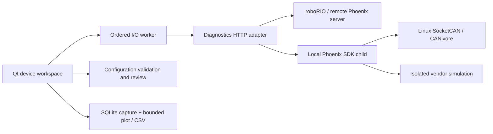

# Architecture

Python 3.10–3.13 (3.12 recommended), Qt 6 via PySide6, pyqtgraph and Phoenix 6. Linux is a native desktop target, not a web wrapper or Wine dependency.

`models.py` defines transport-independent devices, signals, samples and exceptions. `configuration.py` implements metadata validation, model-bound versioned JSON, atomic imports, staged defaults and baseline diffs. `buffered.py` validates native plot records, tracks ordinals/epochs, deduplicates and detects overruns. `telemetry.py` owns the complete transactional SQLite capture, bounded display samples, gaps and CSV. `controls.py` validates and encodes metadata-derived control requests.

`protocol.py` owns the verified POST framing and vendor response status checks, independently of HTTP. `backends/diagnostics.py` implements server operations and HTTP transport error handling. All configuration capabilities are derived from server metadata, without a manually invented parameter list. Configuration writes refresh and compare the baseline first, then write and refresh. There is still a race between baseline check and write: the vendor protocol has no conditional-update transaction. Use only one configuration writer.

`backends/local.py` manages an SDK subprocess, ensures port 1250 is free, captures startup errors, and cleans up. `sdk_host.py` explicitly selects `CTR_TARGET=Hardware` or `Simulation` before loading the native library. Simulation never falls back to hardware. The parent GUI does not load CTRE native libraries. Sensor physics inputs in the simulation host are synthetic and labeled throughout the UI and exported data.

`ui/worker.py` executes ordered blocking I/O on one thread, so writes cannot overlap. Buffered fetching allows one outstanding acquisition; slow targets return more records per fetch rather than creating a backlog of client requests. Overrunning the server ring produces explicit missing-record counts. Each connection has a generation token so results from an old connection are discarded. Device-specific callbacks also check identity. Qt owns all presentation and file dialogs. Closing waits for bounded I/O before destroying the worker.

`ui/window.py` coordinates discovery, history, connection state, dialogs and device operations. `config_editor.py` builds numeric, enum and boolean editors from the server schema. `plotter.py` manages signal selection, pause and graph interactions. Theme colors live in `theme.py`.

Control editing stages parameters. An explicit confirmation arms the editor after target verification; Apply starts `ui/heartbeat.py`: a dedicated thread with its own HTTP connection that sends the request every 40 ms, never queued behind telemetry, discovery or GUI work. The server holds a `controlv2` request over the robot program's requests for only ~200 ms, so a late heartbeat hands the device back to robot code; longer gaps are reported. Re-applying updates the running request. Only one request may be outstanding, and Stop is sent from the same thread after the last request. The GUI feeds a liveness deadline: a 300 ms GUI stall, a 300 ms acknowledgment stall or any request error disarms the session rather than automatically resuming output; control requests have a 250 ms timeout. Leaving Control, device changes, disconnect, write operations and errors stop control. Local SDK enable feeds require a renewable 250 ms authenticated loopback TCP lease (independent of console stdin) and use the official 100 ms enable timeout. The independent native HTTP-control watchdog was tested by keeping enable alive while dropping request heartbeats. All other mutations are guarded at both UI review dialogs and backend `confirmed` arguments. These flags are guardrails for application callers, not security credentials. The vendor HTTP server has no app-level authentication; use it on a trusted robot network.
